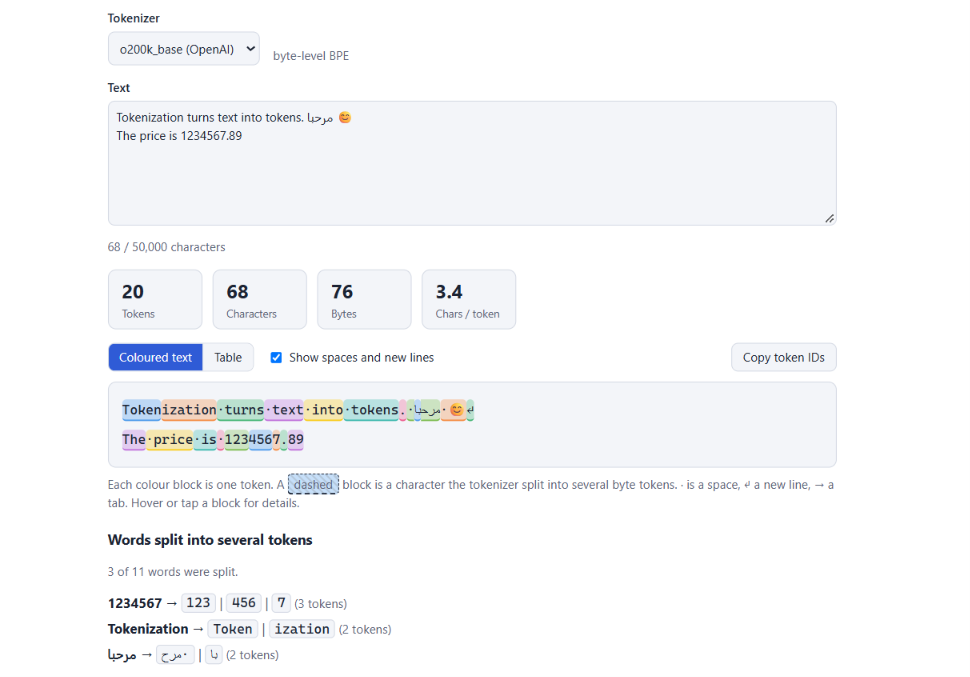
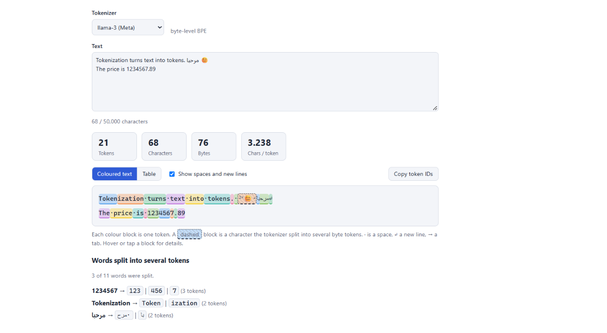
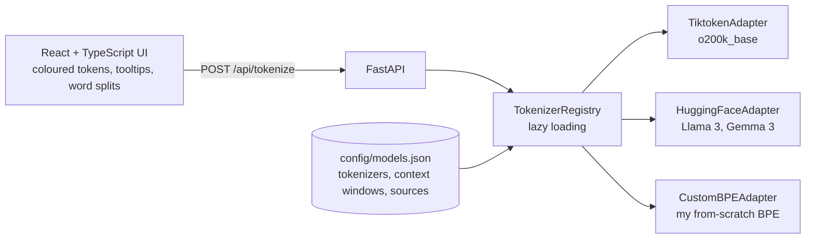

<div align="center">

# Tokenization & Context Window Analyzer

**See how large language models read your text.**
Compare how OpenAI, Llama and Gemma tokenizers split the same sentence, and look at every token, ID and byte.


[Screenshots](#screenshots) · [What I found](#what-i-found) · [Quick start](#quick-start) · [Architecture](#architecture) · [Roadmap](#roadmap)

</div>

---

## Why this project

An LLM never sees words. It sees **tokens**, and the tokenizer decides how many it takes to say something. That decides your **cost**, how much text fits in the **context window**, and even why models are weak at spelling and arithmetic.

This project is a working lab for that idea. It runs real tokenizers, shows exactly where each one cuts the text, and includes a **byte-level BPE tokenizer I wrote from scratch** to understand the algorithm instead of only using it.

> **Status:** working local app (engine, API, web UI). Side-by-side comparison, the context-window simulator and deployment are next (see the [roadmap](#roadmap)). **Live demo:** coming with deployment.

## Screenshots

The same text, two tokenizers. Each colour block is one token.

<table>
  <tr>
    <td width="50%"></td>
    <td width="50%"></td>
  </tr>
  <tr>
    <td align="center"><b>o200k_base</b> (OpenAI): 20 tokens</td>
    <td align="center"><b>Llama 3</b> (Meta): 21 tokens</td>
  </tr>
</table>

- **Coloured text** with a tooltip for every token: ID, piece, text, byte span and character span.
- **Visible whitespace:** `·` is a space, `↵` a new line, `→` a tab.
- **Dashed blocks** mark a character the tokenizer had no token for, so it fell back to raw bytes (one emoji becomes several tokens).
- **Words split into several tokens**, for example `1234567 → 123 | 456 | 7`.
- Table view, **Copy token IDs**, light and dark mode, and a layout that works on a phone.

## What I found

Real counts from this project (`run_compare.py`), one sentence per category:

| Sentence | Characters | `o200k_base` | Llama 3 | Gemma 3 |
|---|---:|---:|---:|---:|
| English: `Tokenization turns text into tokens.` | 36 | 7 | 7 | 7 |
| Arabic sentence | 37 | 13 | 16 | 14 |
| Emoji: `Hello 😊🎉 great job 👍` | 20 | 7 | 10 | 6 |
| Code: `def add(a, b): return a + b` | 31 | 11 | 11 | 13 |
| Numbers: `The price is 1234567.89 on 2026-11-14.` | 38 | 18 | 18 | 27 |

1. **Gemma splits every digit; `o200k_base` and Llama group up to three.** For the numbers sentence the pieces are `1 | 2 | 3 | 4 | 5 | 6 | 7` in Gemma and `123 | 456 | 7` in the other two. That is 27 tokens against 18, and it changes what a model "sees" when it does arithmetic.
2. **Arabic costs about 1.9 to 2.3 times as many tokens as English** of similar length (13, 14 and 16 tokens against 7).
3. **The same count does not mean the same split.** All three give 7 tokens for the English sentence, but the pieces differ: a leading space is written `Ġ` in Llama, `▁` in Gemma and as a plain space in `o200k_base`.
4. **Emoji handling differs a lot.** Llama needs 10 tokens for the emoji sentence, `o200k_base` 7 and Gemma 6. In the screenshots above, Llama breaks 😊 into byte tokens while `o200k_base` keeps it whole.

> **Read this as an observation, not a benchmark.** It is one sentence per category, and the Arabic sentence is not a translation of the English one. A real claim ("Arabic costs X% more") needs a parallel corpus such as FLORES-200 and many sentences. That is a planned next step.

## Quick start

You need **Python 3.10+** and **Node.js 22 LTS**.

```bash
git clone https://github.com/MazenHisham1/Tokenization-Context-Window-Analyzer.git
cd Tokenization-Context-Window-Analyzer
pip install -r requirements.txt
```

Run the API (terminal 1, from the project root):

```bash
uvicorn api.server:app --reload        # http://127.0.0.1:8000  (docs at /docs)
```

Run the web app (terminal 2):

```bash
cd frontend
npm install
npm run dev                            # open http://localhost:5173
```

**Llama and Gemma are gated models.** Accept their licenses on huggingface.co, create a *Read* token, and run `hf auth login` (or set `HF_TOKEN`) on the machine that runs the API. The token stays on the server and never reaches the browser. If a tokenizer cannot load, the app shows a clear error and the other tokenizers keep working.

**Run the tests** (no internet needed):

```bash
pytest                                 # backend
cd frontend && npm test && npm run build   # front-end tests + type check
```

**Compare tokenizers from the command line:** `python run_compare.py` prints a table and saves `results.csv` and `results.md`.

## Architecture



Every tokenizer family sits behind one interface, so the app never needs to know where a token list came from:

```python
Token(id, text, start, end, piece)      # start/end are UTF-8 byte offsets
Tokenizer.encode(text) -> list[Token]   # one adapter per tokenizer family
```

**Design decisions**

- **Byte offsets, not character offsets.** Byte-level tokenizers can split one emoji across several tokens, and a character offset cannot describe half a character. The UI converts to characters when it draws.
- **Lazy loading.** Listing tokenizers never downloads a model. A gated or offline model fails only when it is used, and shows up as an error on that tokenizer alone.
- **Context windows live in `config/models.json`**, each with a `source_url` and a `last_verified` date, because vendors change them often. A validator rejects bad entries and flags ones older than 90 days.
- **Tested without the internet.** Tests build tiny tokenizers locally, and the same contract tests run against every adapter.
- **Robust API.** Clear 404, 503 and 422 errors, a 50,000-character limit, and validation errors that never echo the user's text back.

Models in the config, last verified 2026-11-14 against the vendors' pages:

| Model | Tokenizer | Context window | Source |
|---|---|---:|---|
| GPT-4o | `o200k_base` | 128,000 | [OpenAI model page](https://developers.openai.com/api/docs/models/gpt-4o) |
| Llama 3.1 8B | Llama 3 | 128K (rounded) | [Hugging Face blog](https://huggingface.co/blog/llama31) |
| Gemma 3 (4B, 12B, 27B) | Gemma 3 | 128K | [Gemma 3 model card](https://ai.google.dev/gemma/docs/core/model_card_3) |

## BPE from scratch

`src/bpe.py` is a byte-level BPE tokenizer written without any tokenizer library: it trains merges, encodes, decodes, and supports special tokens. A test builds a real `tiktoken.Encoding` from **my own merges** and checks that both produce identical token IDs on the test strings, which confirms the algorithm matches tiktoken's. The notebook in [`notebooks/`](notebooks/) walks through it step by step.

## API

| Method | Path | Purpose |
|---|---|---|
| `GET` | `/api/tokenizers` | Names and metadata (never loads a model) |
| `POST` | `/api/tokenize` | `{text, tokenizer}` returns the count and every token (id, text, piece, byte span) |
| `GET` | `/api/models` | Context windows from the config, with source and verification date |
| `GET` | `/api/limits`, `/api/health` | Limits and a health check |

```bash
curl -X POST http://127.0.0.1:8000/api/tokenize \
     -H "Content-Type: application/json" \
     -d '{"text": "Hello 😊", "tokenizer": "my-bpe"}'
```

## Project structure

```
config/models.json   tokenizers and models (context window, source URL, last_verified)
src/                 engine: from-scratch BPE, adapters, registry, config loader
api/                 FastAPI server
frontend/            React + TypeScript (Vite): coloured view, tooltips, word splits
tests/               pytest suite for the engine and the API
notebooks/           BPE from scratch, tokenizer comparison
docs/                design notes and phase walkthroughs
```

More detail: [engine design](docs/DESIGN.md) · [web app walkthrough](docs/PHASE3_WALKTHROUGH.md) · [coloured view walkthrough](docs/PHASE4_WALKTHROUGH.md)

## Roadmap

- [x] **Phase 0:** BPE from scratch, notes on why subwords exist
- [x] **Phase 1:** core engine comparing tiktoken and Hugging Face tokenizers
- [x] **Phase 2:** common interface, adapters, registry, sourced config
- [x] **Phase 3:** API and web MVP
- [x] **Phase 4:** colored token view, tooltips, word splits
- [ ] **Phase 5:** side-by-side comparison with charts
- [ ] **Phase 6:** context-window simulator (what is kept or dropped on overflow)
- [ ] **Phase 7:** CI, accessibility and performance work
- [ ] **Phase 8:** deployment, plus a multilingual token-cost study

## Known limitations

- The colored view shows the first 2,000 tokens, and the table the first 1,000, to keep the page fast.
- Keyboard users cannot move between the colored blocks; the Table view is the accessible alternative for now.
- Tokenizers that are not published (some closed models) can only be estimated, not run. The interface has an `exact` flag for this, but no such adapter exists yet.
- Tested in Chromium. Not yet checked in Safari or Firefox.
- Not deployed yet.

## License and credits

See [LICENSE](LICENSE). Built with [tiktoken](https://github.com/openai/tiktoken), [Hugging Face Transformers](https://github.com/huggingface/transformers), [FastAPI](https://fastapi.tiangolo.com) and [React](https://react.dev). The Llama and Gemma tokenizers are loaded from Hugging Face under their own licenses and are not included in this repository.
